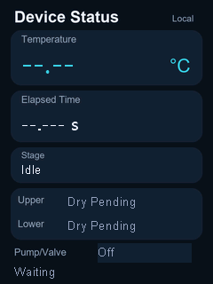

# Automated Ubbelohde Viscometer

English interface and source files for the automated Ubbelohde viscometer developed by OUC-China.

## Source and Downloads

| Module | Browse files | Download package |
| --- | --- | --- |
| Serial display | [Display project and resources](display/) | [hmi-en.zip](https://github.com/NEW-Euglena/ouc-china-viscometer/releases/download/v1.0.0/hmi-en.zip) |
| Controller firmware | [STM32 source and build files](firmware/) | [firmware-en.zip](https://github.com/NEW-Euglena/ouc-china-viscometer/releases/download/v1.0.0/firmware-en.zip) |
| Monitoring interface | [English web interface and receiver](web/) | [web-en.zip](https://github.com/NEW-Euglena/ouc-china-viscometer/releases/download/v1.0.0/web-en.zip) |

```text
ouc-china-viscometer/
  README.md
  display/       Serial-display project, compiled screen, fonts, and preview
  firmware/      STM32 application, peripheral drivers, and build configuration
  web/           Browser interface, telemetry receiver, and calculation checks
```

Each module includes its own file guide and usage instructions. The downloadable packages retain their packaged directory layout; extract the three packages into the same directory to preserve their cross-links.

## Serial Display

The 240 x 320 portrait interface displays temperature, measurement stage, elapsed time, upper and lower liquid-level states, pump/valve status, and temperature-probe status. The package contains an editable `.HMI` project and a compiled `.tft` screen file.



## Controller Firmware

The STM32G071RB firmware coordinates temperature acquisition, pneumatic actuation, liquid-level detection, efflux timing, serial-display updates, and telemetry. The project includes CMake configuration and an ARM GCC toolchain file.


## Monitoring and Calculation Interface

The English browser interface provides device status, temperature history, manual calculation, and automatic timing-data input. The Python receiver supports USB serial telemetry and HTTP telemetry.

The calculation workflow converts efflux time into relative viscosity, estimates intrinsic viscosity with the Solomon-Ciuta single-point method, and estimates molecular weight using the project calibration relationship. Concentration is expressed in g/dL, intrinsic viscosity in dL/g, and molecular weight estimates in Da.

## Dependencies and Resources

- Display editing: a compatible USART HMI editor for the TJC3224T124_011C_A01 screen.
- Firmware building: STM32Cube tools, CMake, Ninja, and ARM GCC.
- Telemetry receiver: Python 3.10 or later; USB serial reception uses `pyserial`.
- Calibration checks: Node.js.

Third-party driver license files and copyright notices are included in the firmware package.
